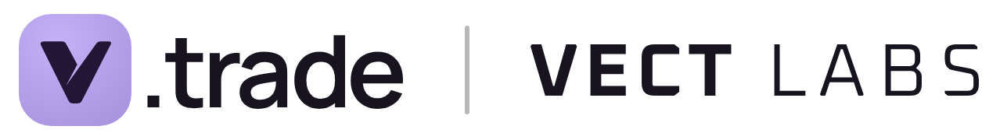
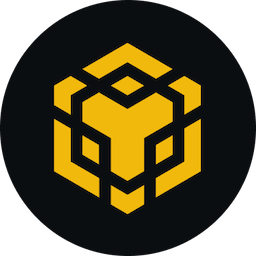
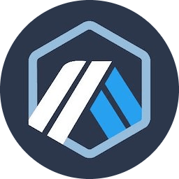

<p align="center">
  <picture>
    <source media="(prefers-color-scheme: dark)" srcset="assets/vect-lockup-dark.png">
    
  </picture>
</p>

## Contracts

The source of each contract is the same on every chain; only its deployment configuration differs. Each chain has its own folder under [`deployments/`](deployments/) with that configuration, the deployed address and its verified source.

<div align="center">

| Contract | Address | <a href="deployments/robinhood/"></a> | <a href="deployments/base/"></a> | <a href="deployments/bnb/"></a> | <a href="deployments/arbitrum/"></a> | <a href="deployments/ethereum/"></a> |
|:--|:--|:-:|:-:|:-:|:-:|:-:|
| [`VectExecutor`](exec01/) | — | RC | — | — | — | — |

<sup>**✓** Deployed &emsp;&emsp; **RC** Release candidate (not deployed) &emsp;&emsp; **—** Not deployed</sup>

</div>

Only the addresses listed in this repository, in the table above and in [`deployments/<chain>/`](deployments/), are official VECT LABS contracts.

`VectExecutor` is a stateless swap executor. When a user submits a signed swap, it routes the user's tokens across Uniswap v2, v3 and v4 pools and concentrated-liquidity fork factories in one transaction. It has no owner, no admin, no upgrade and no pause, and it holds no funds between transactions. Status everywhere: internally reviewed, not audited by an external firm. Details: [`exec01/README.md`](exec01/README.md).

The source of every contract VECT LABS deploys, or intends to deploy, is published in this repository with its tests.

## Security

- **Review:** internal review only, no external audit. Scope, methods and limits are in [`SECURITY-REVIEW.md`](SECURITY-REVIEW.md).
- **Reporting a vulnerability:** write privately to **security@vect.trade**; see [`SECURITY.md`](SECURITY.md). No bug bounty is offered at this time.

## Build and verify

The contracts are written in **Solidity 0.8.38** (EVM `cancun`, optimizer 200 runs, via IR). Every deployment is built with these settings, so its bytecode can be reproduced exactly and verified on [Sourcify](https://sourcify.dev) from its tagged source in this repository. Building requires [Foundry](https://book.getfoundry.sh/); the fork suites also need an archive-capable Robinhood Chain RPC.

```
cd exec01
export ROBINHOOD_RPC=<archive RPC URL>
forge build
forge test
```

## License and trademark

The code is provided under the [MIT licence](LICENSE), "as is", without warranty of any kind.

VECT is a trademark of VECT LABS. This licence grants no right to use the VECT name or logo; the logos in `assets/` are not covered by the MIT licence. Chain logos belong to their respective owners and only identify each chain; they imply no affiliation or endorsement.

Using these contracts directly, outside vect.trade, is at your own risk and is not a service of VECT LABS. For vect.trade users, the vect.trade Terms of Use apply.

Nothing in this repository is an offer or a solicitation to buy or sell any crypto-asset or financial instrument, or investment advice.
